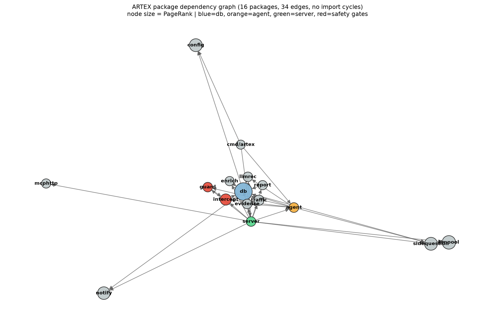
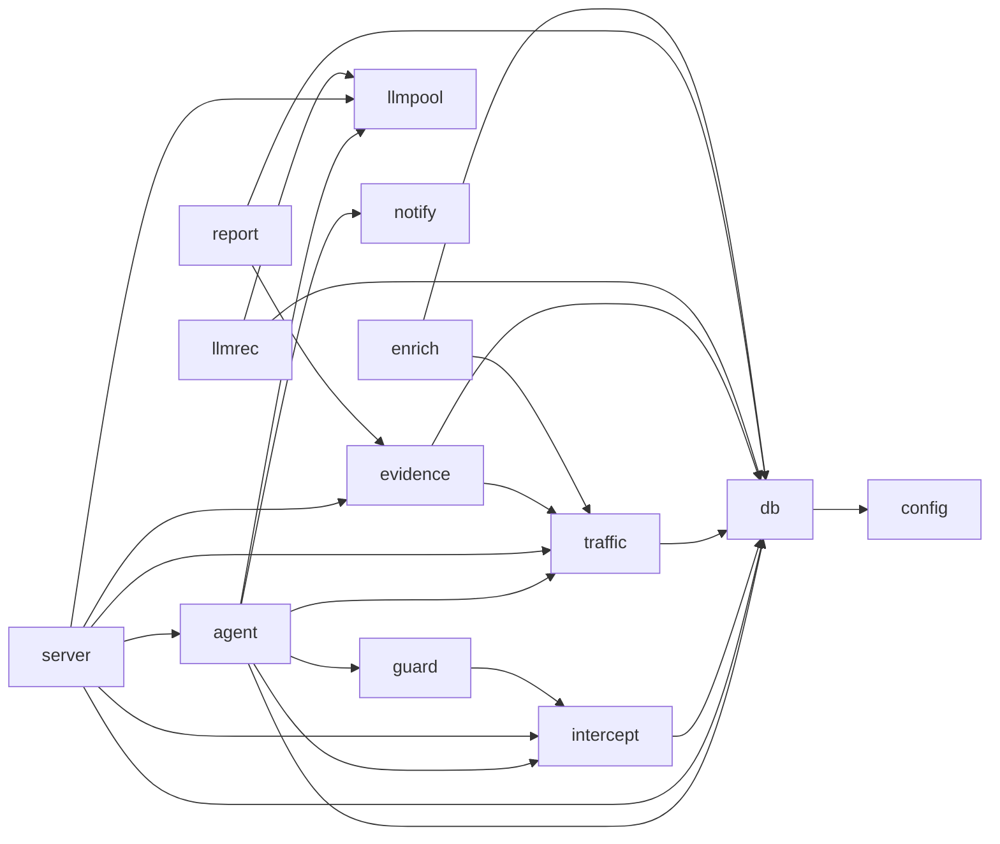

# Patterns borrowed from ARTEX

ARTEX (`github.com/BaaRai/ARTEX`, Go, pinned at `7f8c7cb`) is an autonomous
penetration-testing platform. The harness in this repository is a different size
and a different target class, but both solve the same problem: an LLM-driven
tester must plan work, execute it against a hostile endpoint, prove findings,
and keep evidence that survives review.

This document records what ARTEX does, what was copied, and what is still open.

## Method

No Go toolchain was installed, so the analysis used tree-sitter's Go grammar from
Python plus networkx:

- every `.go` file parsed into packages, imports, functions, methods, structs,
  interfaces and call sites;
- a package-import graph and a call graph (receiver and package-qualified calls
  resolved where the type or alias is visible);
- PageRank, betweenness, strongly connected components and dead-code checks on
  both graphs.

Reproduction:

```bash
python artex_ast.py /path/to/ARTEX artex_graph.json   # analyzer lives in this repo's parent tmp/
```

## Scale

| metric | value |
|---|---|
| Go files | 362 |
| LOC | 96,856 |
| first-party packages (directories) | 16 |
| functions / methods | 1,588 / 1,568 |
| structs / interfaces | 400 / 9 |
| import declarations | 2,255 |
| raw call sites | 32,391 |
| resolved call-graph nodes / edges | 3,155 / 1,808 |
| HTTP routes | 258 |

The package graph has **34 edges and no import cycles**; the largest call-graph
SCC is 2. `db` is the hub (PageRank 0.217, in-degree 8, out-degree 3), followed by
`llmpool` (0.110), `config` (0.096), `sidequestion` (0.095) and `notify` (0.090).
In the call graph, `db/Open` (in-degree 89), `server/NewManager` (60), `server/
NewEngine` (33) and `llmpool/NewRegistry` (18) are the load-bearing functions.





## The agentic strategies in ARTEX

### 1. Planner and worker are separate roles, joined by an intent frontier

`agent/planner.go` is the only intent generator. `agent/worker.go` claims one
intent, executes it with tools, writes facts back, and stops. Workers never hunt
for new directions; the planner never executes. A hard floor in the planner
prompt (`planner.go:316`) forces at least one new intent whenever the frontier is
empty and the goal is unmet, so a run cannot idle when it still has budget.

### 2. Runs end for a named reason

`agent/terminalreason.go` maps every harness termination (turns, wall clock, model
error, blocking limit, hook stop, abort) to a hint, and records the in-flight call
in `runTrace` so an interrupted run can be explained. A string like `"stopped"`
tells a dashboard nothing.

### 3. Stagnation detection disarms a repeated direction

`detectStagnation` in `agent/stagnation_test.go` normalizes completed intents,
counts repeats of the same direction (3 triggers it), and treats **any finding as
disarming the direction**. A plan that keeps re-listing endpoints without finding
anything is a signal to change strategy, not to send more probes.

### 4. A dedicated retester with a verdict contract

`agent/retester.go` gives retests their own prompt, session and tools. The verdict
is an enum — `reproduced`, `fixed`, `inconclusive` — and each verdict requires
cited requests/responses, with an explicit instruction to argue the opposite case
along reachability, preconditions, reproducibility, scope and impact.

### 5. Guard hooks gate every side effect and attribute failures

`guard/guard.go` registers `PreToolUse` and `PostToolUse` hooks, writes an
`AuditEntry` (timestamp, tool, allow/block, reason, command digest) for every call,
and keeps a bounded trail (2,000 entries). `PostToolUse` classifies results into
`blocked / error / ok` so the planner learns the difference between a WAF and a
transport failure. A platform block is framed as "platform control, not target
defense" so the agent stops trying to evade its own policy.

### 6. Human approval sits inside the loop

`intercept/` pauses an `ask` decision, writes a pending approval record, and either
resumes with `allow` or returns a block. Approvals record who, what and why, so a
review can reconstruct a destructive call.

### 7. Evidence is stored and bound to findings

`evidence/store.go` writes captured response bodies to disk after verifying length
and hash, and findings bind traffic IDs in reproduction order. Without the binding
a finding is a claim; with it, it is a reproducible record.

### 8. Provider pool with a circuit breaker

`llmpool` fails over on no-credit, trips on hard failures immediately, needs
repeated soft failures, grows a backoff ladder and never fails over after
streaming has started. `llmrec` records every request, retry attempt, usage and
latency, including on cancellation and provider failure.

### 9. Prompts and libraries are versioned, editable seeds

`agent/promptcatalog.go` enumerates the built-in prompt bodies as seed rows, with
code-fixed sections kept out of the editable catalog. `RSI.md` writes the contract
for changing them: live tasks may propose, benchmarks adopt, immutable surfaces
(gates, scope checks, injection defenses, tool allowlists) are never in the search
space, and every adoption is a one-step rollback.

### 10. The exploration graph is a first-class data structure

`agent/coldgraph.go` is pure graph code (hot/cold judgment, connectivity
grouping, union-find, content signatures) deliberately free of DB and LLM
dependencies so it can be unit-tested. The UI renders the same graph.

## What was implemented here

| ARTEX pattern | ARTEX source | redteam-agent change |
|---|---|---|
| Named terminal reasons | `agent/terminalreason.go` | `redteam_agent/runstate.py` `StopReason`; `agent.run()` sets `stop_reason`, report carries `run.stop_reason` |
| Intent frontier | `agent/planner.go`, `worker.go` | `runstate.Frontier`; each attack is an intent with `open/running/done/exhausted/blocked/dropped`, reported as `frontier` |
| Stagnation detection | `agent/stagnation_test.go` | `config.stagnation_rounds` (default 6 unproductive attack rounds), open intents `DROP`ped with reason on trigger |
| Dead-provider breaker | `llmpool` hard-failure tests | `config.target_error_limit` (default 3 consecutive probe errors) stops with `target unhealthy` |
| Retester verdicts | `agent/retester.go` | `redteam_agent/retester.py`; findings get `reproduction_verdict` and an evidence bar (indicator or tool call) |
| Guard hooks + audit | `guard/guard.go` | `redteam_agent/guard.py`; pre-probe block on duplicate payload+mutation, post-probe `ok/blocked/error` attribution, bounded `AuditEntry` trail, report `audit` section |
| Evidence store | `evidence/store.go` | `redteam_agent/evidence.py`; hash-chained `probes.jsonl`, `manifest.json`, `--evidence-dir`; findings carry `probe_seq` + `evidence_digest` |
| Quality gate | `finding_quality_seed_test` | `redteam_agent/gates.py`; each finding gets `quality: pass|quarantine` with reasons, counted in the report |
| Versioned library | `agent/promptcatalog.go`, `RSI.md` | `LIBRARY_VERSION` + `LIBRARY_SHA256` in `attacks.py`, copied into evidence manifest and report |

Behavior changes worth knowing:

- `max_turns` is now enforced; it was counted but never compared before.
- `--stagnation-rounds`, `--target-error-limit`, `--evidence-dir`,
  `--no-quality-gate` are new flags; their config-file values are no longer
  clobbered by argparse defaults (`api_key_env`, `output_dir`, `judge_model`,
  `canary` were fixed too).
- Retests that never go out are `inconclusive`, not silently unconfirmed.

## Still open

1. **Intercept-style approval for live runs.** Our retester and guard run after
   the fact. Add a `--require-approval-for` category list that pauses before
   probes whose expected success involves a state-changing tool (`LLM06`, `ASI02`,
   `ASI10`), writes a pending record, and resumes on approve.
2. **LLM planner with validation.** Replace the deterministic plan with an optional
   LLM planner (ARTEX `planner.go`), validated against the attack library and the
   hard floor; benchmark it on the mock suite before defaulting on.
3. **Retester budget and quota.** Give retests their own budget, mirroring
   `llmrec` usage accounting, so confirmation cannot starve coverage.
4. **Judge provider pool.** Wrap the LLM judge in a failover/breaker layer with
   backoff and recorded usage; today a judge outage degrades silently to rules.
5. **Evidence binding to transcripts.** Bind each finding to the exact probe rows
   and a per-category coverage graph edge, then render the graph in the report.
6. **RSI contract for payload proposals.** Add `docs/rsi-payload-contract.md`:
   probe results may propose payloads, the mock regression suite must adopt them,
   judges and scope checks stay immutable, adoption is one version bump plus one
   rollback pointer.
7. **Test coverage for the new roles.** `tests/test_agentic.py` covers the frontier,
   guard, evidence chain, retester verdicts, gates, stagnation and breaker. The
   HTTP transport still has no live-server test (retries, redirect refusal, 429).
